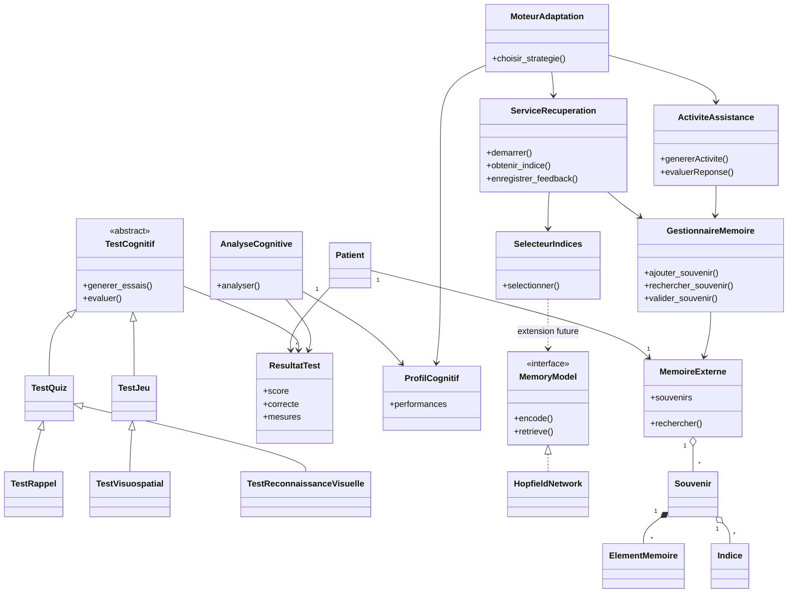
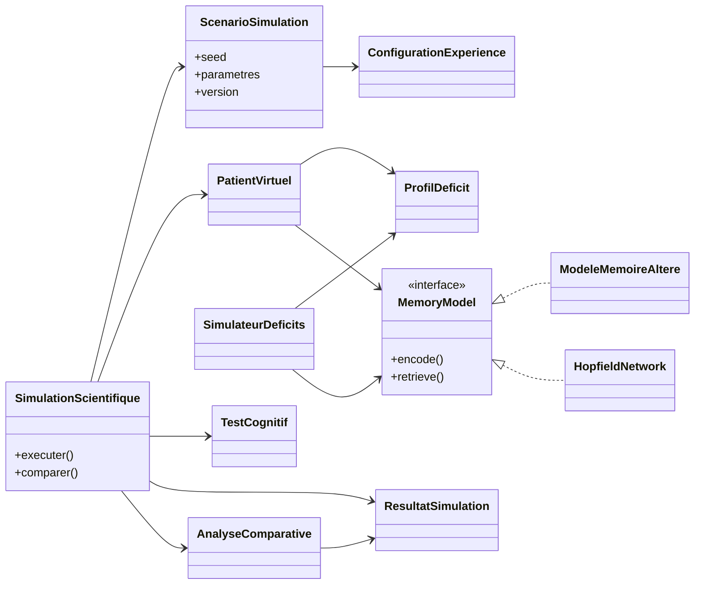

# Architecture de référence

Les diagrammes décrivent les objets étudiés et leurs interactions. Une classe n'est
matérialisée en Python que lorsqu'elle porte une responsabilité actuelle; les extensions
scientifiques restent documentées sans implémentation factice.

## Système d'assistance cognitive



Correspondance actuelle :

| UML | Python | État |
|---|---|---|
| `Patient` | `app.cognitive.patient` | Implémenté (participant, entité ORM) |
| `Souvenir` | `app.memory.external.souvenir` | Implémenté (entité ORM) |
| `ElementMemoire` | `app.memory.external.element_memoire` | Implémenté (entité ORM) |
| `Indice` | `app.memory.external.indice` | Implémenté (entité ORM) |
| `MemoireExterne` | `app.memory.external.memoire_externe` | Implémenté (collection logique, sans table) |
| `TestCognitif` | `app.cognitive.tests.base.test_cognitif` | Abstraction implémentée |
| `TestQuiz`, `TestJeu` | `app.cognitive.tests.base` | Spécialisations abstraites |
| `TestRappel` | `app.cognitive.tests.test_rappel` | Implémenté |
| `TestVisuospatial` | `app.cognitive.tests.test_visuospatial` | Implémenté |
| `TestReconnaissanceVisuelle` | `app.cognitive.tests.test_reconnaissance_visuelle` | Implémenté |
| `ResultatTest` | `app.cognitive.assessment.resultat_test` | Implémenté |
| `ProfilCognitif` | `app.cognitive.assessment.profil_cognitif` | Implémenté |
| `AnalyseCognitive` | `app.cognitive.assessment.analyse_cognitive` | Implémenté |
| `GestionnaireMemoire` | `app.memory.external.gestionnaire_memoire` | Implémenté |
| `MoteurAdaptation` | `app.assistance.adaptation.moteur_adaptation` | Implémenté |
| `SelecteurIndices` | `app.assistance.retrieval.selecteur_indices` | Implémenté |
| `ServiceRecuperation` | `app.assistance.retrieval.service_recuperation` | Implémenté |
| `MemoryModel` | `app.memory.models.memory_model` | Interface uniquement |
| `ActiviteAssistance` | `app.assistance.activities.activite_assistance` | Squelette, non fonctionnel |
| `HopfieldNetwork` | `app.memory.models.hopfield.hopfield_network` | Squelette, aucun réseau implémenté |

`MemoireExterne` est une collection logique des souvenirs du patient; aucune table vide
n'est créée. Les réponses persistées dans `ReponseSession` constituent la trace durable
des `ResultatTest`.

## Système de simulation scientifique



`PatientVirtuel`, `SimulateurDeficits` et `ModeleMemoireAltere` existent uniquement comme
squelettes levant `NotImplementedError`. `SimulationScientifique`, `ScenarioSimulation`,
`ProfilDeficit`, `ResultatSimulation` et `AnalyseComparative` restent documentés sans classe
Python. `ConfigurationExperience`, utilisée par les sessions réelles, est implémentée dans
la persistance. Aucun comportement de simulation n'est fourni.

## Orchestration de recherche et persistance

`GestionnaireTests` (`app.research.experiments.gestionnaire_tests`) orchestre les protocoles
et les sessions; il ne génère ni ne score lui-même les essais. `ProtocoleEvaluation`
(`app.research.protocols.protocole_evaluation`) est un squelette non fonctionnel. Les traces
SQLAlchemy (`SessionTest`, `ReponseSession`, `ConfigurationExperience`, sessions de
récupération) sont regroupées dans `app.persistence.models`; les schémas Pydantic sont dans
`app.persistence.schemas`.

## Interactions entre composants

```text
API ──> research ──> cognitive
 │          │
 ├──> assistance ──> memory
 │          │
 └──────────┴──────────────> persistence / SQLAlchemy

simulation (future) ──> cognitive + memory.models
```

`MemoriaeV2` (`app.memory.models.memoriae_v2`) implémente `MemoryModel` pour le protocole
Fashion-MNIST à image partielle. Son encodeur, son décodeur et sa mémoire Modern Hopfield sont
indépendants de FastAPI et SQLAlchemy; l'orchestration et la persistance de ses exécutions
restent dans `app.research.experiments.model_execution`. Les autres modèles demeurent des
extensions futures.
